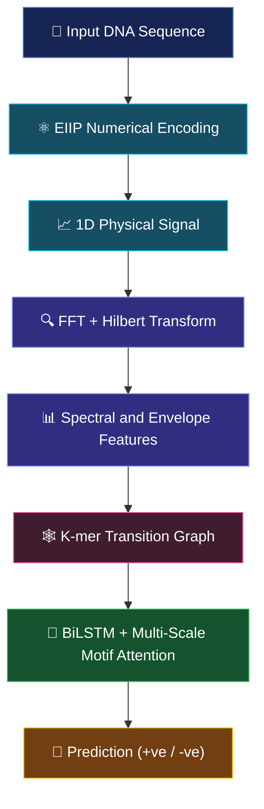

# 🫁 AI-Based Early Lung Cancer Detection and Classification from Genomic Signals

<p align="center">


**An AI-driven genomic signal processing and deep learning framework for early-stage lung cancer detection and classification.**

</p>

---

## 🎓 Academic Information

| **Category** | **Details** |

|:---|:---|

| **Academic Affiliation** | Siddaganga Institute of Technology, Tumakuru, Karnataka |

| **Department** | Computer Science & Engineering |

| **Academic Year** | 2025–26 |

| **Project Guide** | Mr. Gururaj S P (Assistant Professor, Dept. of CSE) |

### 👨‍💻 Engineering Team

| **Name** | **USN** |

|:---|:---|

| Shreeya H M | 1SI23CS167 |

| Vidhyashree U | 1SI23CS194 |

| Shrinivas Bhagavantagoudar | 1SI23CS169 |

| Shrishantha | 1SI23CS170 |

---

## 📌 Project Overview & Problem Statement

Early detection of lung cancer dramatically enhances patient survival rates from under 15% to over 60%, yet conventional diagnostic modalities (chest radiography and symptomatic presentation) frequently identify malignancies only at advanced, metastatic stages (Stage III/IV).

This project investigates the utilization of **1D genomic signals extracted from DNA sequences** (such as circulating tumor ctDNA liquid biopsies or tissue aspirates) for early-stage lung cancer detection and classification through digital signal processing (DSP) and deep learning.

### 🎯 Formal Project Objectives

1. **Objective 1:** Develop an AI-driven computational framework for detecting early-stage lung cancer–related somatic mutations and genomic alterations using **Electron-Ion Interaction Pseudopotential (EIIP)** encoding.

2. **Objective 2:** Design and implement a robust **PyTorch Bidirectional LSTM model with Attention pooling** capable of detecting and categorizing lung cancer into clinically relevant subtypes (Normal Wild-Type, TP53 Somatic Alterations, EGFR Activating Mutations, KRAS Driver Mutations).

3. **Objective 3:** Perform a systematic comparative study between AI models trained on **genomic signals** and the state-of-the-art **PET/CT Foundation Model for Cross-Modal Anatomical and Functional Imaging** ([FratMAE, arXiv:2503.02824](https://arxiv.org/html/2503.02824v1)), highlighting their complementary capabilities for precision oncology.

---

## 🔬 End-to-End Diagnostic Pipeline

The following diagram illustrates the complete genomic signal processing and classification workflow.



---

## 🧮 Algorithms

### Algorithm 1 — DNA Sequence Preprocessing Algorithm

**Purpose:** Sanitize, validate, and standardize raw DNA input before feature extraction.

**Steps:**

1. Accept raw DNA string from dataset column `DNA_Sequence`.

2. Strip all whitespace and newline characters; convert to uppercase.

3. Validate that all characters belong to `{A, C, G, T}`; reject sequences shorter than 50 bp.

4. Standardize to exactly **500 base pairs**:

   - If `len < 500`: tile and truncate (preserves periodic signal properties).

   - If `len > 500`: truncate to first 500 characters.

5. Any ambiguous base is mapped to the population mean EIIP value (`0.1185 Ry`).

6. Apply stratified 70% / 15% / 15% train–val–test split by class label.

**Output:** A clean, fixed-length 500-character DNA string.

---

### Algorithm 2 — EIIP Numerical Encoding Algorithm

**Purpose:** Convert the symbolic DNA sequence into a 1D real-valued physical signal using the Electron-Ion Interaction Pseudopotential (EIIP) model.

The EIIP encoding function maps each nucleotide base \(b_i\) at position \(i\) to its characteristic electron energy potential \(e(b_i)\), producing a discrete 1D signal:

\(s[i] = e(b_i), \quad i = 1, 2, \ldots, N, \quad N = 500\)

where \(e : \{A, C, G, T\} \rightarrow \mathbb{R}\) is defined by the following mapping (in Rydberg units):

| **Nucleotide** | **EIIP Value \(e(b)\) (Ry)** | **Physical Interpretation** |

|:---:|:---:|:---|

| Adenine (A) | `0.1260` | Purine ring electron energy |

| Cytosine (C) | `0.1340` | Pyrimidine ring electron energy |

| Guanine (G) | `0.0806` | Purine ring electron energy |

| Thymine (T) | `0.1335` | Pyrimidine ring electron energy |

| Unknown / Pad | `0.1185` | Population mean fallback |

**Output:** A 1D float32 signal array \(s \in \mathbb{R}^{500}\) — the **EIIP genomic signal**.

**Why EIIP?** It converts discrete symbolic sequences into a continuous numerical representation that preserves physicochemical relationships between bases, enabling spectral analysis techniques (FFT, Hilbert) that are not applicable to character strings.

---

### Algorithm 3 — Genomic Signal Feature Extraction Algorithm

**Purpose:** Extract multi-channel temporal features and topological graph metrics from the 1D EIIP signal that capture mutation-specific spectral and structural signatures.

#### 3A — Fast Fourier Transform (FFT) Spectral Analysis

Given the detrended EIIP signal \(\tilde{s}[n] = s[n] - \bar{s}\), the Discrete Fourier Transform is:

\(X[k] = \sum\_{n=0}^{N-1} \tilde{s}[n] \cdot e^{-j 2\pi kn / N}, \quad k = 0, 1, \ldots, N-1\)

The **Power Spectral Density** (single-sided, positive frequencies only):

\(\text{PSD}[k] = \frac{|X[k]|^2}{N}, \quad k = 0, 1, \ldots, \frac{N}{2}-1\)

**3-Base Periodicity Detection** — protein-coding exons exhibit a dominant energy peak at:

\(f\_{codon} = \frac{1}{3} \approx 0.333 \text{ (normalized frequency)}\)

Somatic frameshifts and nonsynonymous mutations disrupt this peak. The **periodicity ratio** quantifies the fraction of total spectral energy concentrated around \(f = 1/3\):

\(R\_{1/3} = \frac{\sum\_{k \in \mathcal{W}} \text{PSD}[k]}{\sum\_{k} \text{PSD}[k]}, \quad \mathcal{W} = \\{k : |f_k - 1/3| < \epsilon\\}\)

Extracted features
- Periodicity ratio (periodicity_ratio):
  \[
  R_{1/3} = \frac{\displaystyle\sum_{k \in \mathcal{W}} \mathrm{PSD}[k]}{\displaystyle\sum_k \mathrm{PSD}[k]}
  \]
- Spectral centroid (spectral_centroid):
  \[
  \bar{f} = \frac{\displaystyle\sum_k f_k \cdot \mathrm{PSD}[k]}{\displaystyle\sum_k \mathrm{PSD}[k]}
  \]
- Peak frequency (peak_frequency):
  \[
  f_{\mathrm{peak}} = f_{k^*}, \qquad k^* = \underset{k}{\arg\max}\; \mathrm{PSD}[k]
  \]
- Spectral entropy (spectral_entropy):
  \[
  H_s = -\sum_k p_k \log_2(p_k),
  \qquad
  p_k = \frac{\mathrm{PSD}[k]}{\sum_j \mathrm{PSD}[j]}
  \]
#### 3B — Hilbert Transform Feature Extraction

The Hilbert Transform constructs the **analytic signal**:

\(z[n] = \tilde{s}[n] + j\\,\mathcal{H}\\{\tilde{s}[n]\\}\)

where \(\mathcal{H}\{\cdot\}\) denotes the Hilbert operator (90° phase shift of all frequency components).

**Instantaneous Amplitude Envelope** — reveals mutation cluster spikes:

\(A[n] = |z[n]| = \sqrt{\tilde{s}[n]^2 + \mathcal{H}\\{\tilde{s}[n]\\}^2}\)

**Instantaneous Frequency** — locates phase instability at mutation loci:

\(f_i[n] = \frac{1}{2\pi} \cdot \frac{d}{dn}\\,\angle\\,z[n] = \frac{\Delta\phi[n]}{2\pi}\)

**Crest Factor** (peak-to-average ratio, elevated near mutation hotspots):

\(CF = \frac{\max(A[n])}{\bar{A} + \epsilon}\)

**Extracted features:** `mean_envelope` \(\bar{A}\), `envelope_variance` \(\sigma_A^2\), `crest_factor` \(CF\), `envelope_entropy` \(H_A\).

#### 3C — Multi-Channel Sequential Matrix Assembly

The three signal channels are stacked column-wise into a multi-channel sequential input matrix ready for the deep learning model:

\(\mathbf{X} \in \mathbb{R}^{500 \times 3} = \begin{bmatrix} s[1] & A[1] & f_i[1] \\\ s[2] & A[2] & f_i[2] \\\ \vdots & \vdots & \vdots \\\ s[500] & A[500] & f_i[500] \end{bmatrix}\)

| **Channel** | **Signal** | **Captures** |

|:---:|:---|:---|

| 0 | EIIP value \(s[n]\) | Raw nucleotide physicochemical composition |

| 1 | Hilbert envelope \(A[n]\) | Mutation cluster amplitude spikes |

| 2 | Instantaneous frequency \(f_i[n]\) | Phase instability at mutation loci |

#### 3D — K-Mer Transition Graph (Topological Features)

1. Extract all overlapping **trinucleotide k-mers** (\(k=3\)) — giving up to \(N - k + 1 = 498\) k-mers per sequence.

2. Build a directed graph \(G = (V, E)\) where nodes \(V\) are unique k-mers, directed edges \(E\) are sequential transitions \((k_i \to k_{i+1})\), and edge weights are transition frequencies.

3. Compute graph-level topology metrics:
- Graph Density:
  \[
  \rho = \frac{|E|}{|V|\,(|V|-1)}
  \]
- Transition Shannon Entropy:
  \[
  H_T = -\sum_{v \in V} \sum_{u \in \mathcal{N}^+(v)}
  p(v \to u)\,\log_2\bigl(p(v \to u)\bigr)
  \]
- Average Clustering Coefficient:
  \[
  \bar{C} = \frac{1}{|V|}\sum_{v \in V} C_v
  \]
- Spectral Radius:
  \[
  \rho_s = \max_{\lambda \in \mathrm{spec}(\mathbf{A}_G)} |\lambda|
  \]
  where \(\mathbf{A}_G\) is the graph adjacency matrix.
**Output:** Shape \((500, 3)\) multi-channel sequential feature matrix, ready for the deep learning model.

---

### Algorithm 4 — Lung Cancer Classification Algorithm

**Purpose:** Binary classification of a genomic signal as Cancer Positive (+ve) or Normal Negative (−ve) using a CNN–BiLSTM architecture with self-attention mutation hotspot localization.

#### Model Architecture: GenomicLSTMClassifier

| **Stage** | **Operation** | **Detail** |

|:---:|:---|:---|

| 1 | In-model channel normalization | Zero-mean, unit-variance per sequence |

| 2 | Multi-scale 1D Conv motif detection | Parallel Conv1D kernels: **3** (triplet codons), **5** (mutation hotspots), **7** (splice motifs), **11** (broader genomic domains) → 128 feature maps |

| 3 | GroupNorm + MaxPool1d(2) | Normalize across feature groups; reduce sequence length by 2× |

| 4 | 2-Layer Bidirectional LSTM | `hidden=128`, bidirectional → effective hidden size `256` |

| 5 | Genomic Self-Attention Pooling | Learns per-position importance weights; highlights mutation hotspot loci |

| 6 | Temporal Max Pooling | Captures peak disruption signal across the sequence |

| 7 | Macro Statistics Skip Connection | Appends global \([\mu, \sigma, \max, \min]\) per channel (12 values) |

| 8 | Fused Feature Vector | Attention pooled (256) + Max pooled (256) + Stats (12) = **524 dimensions** |

| 9 | Dense Head (LayerNorm + GELU) | 524 → 128 → 64 with LayerNorm and GELU activations |

| 10 | Binary Classifier | 64 → 2 logits → Softmax → \(P(\text{Normal})\) and \(P(\text{Cancer})\) |

#### Training Procedure

| **Hyperparameter** | **Value** |

|:---|:---|

| Optimizer | AdamW (weight decay = 1e-3) |

| Learning Rate | 0.001 with CosineAnnealingLR |

| Loss Function | CrossEntropyLoss (label smoothing = 0.03) |

| Gradient Clipping | max_norm = 1.0 |

| Dropout | 0.20 (LSTM & dense head) |

| Batch Size | 32 |

| Epochs | Up to 20 (early stopping, patience = 8) |

#### Decision Threshold Calibration (Youden's J-Statistic)

After training, the optimal decision boundary is computed on the validation set:

\(J = \text{TPR} - \text{FPR}\)

The threshold maximizing \(J\) is selected and clipped to \([0.40, 0.65]\). **Current calibrated threshold: 0.40.**

**Output:** Binary label (`Cancer +ve` / `Normal −ve`) + confidence score + per-nucleotide attention weight profile.

---

### Algorithm 5 — Comparative Analysis Algorithm

**Purpose:** Benchmark the genomic detection pipeline against an imaging-based foundation model across 14 clinical and technical dimensions.

**Reference:** [Developing a PET/CT Foundation Model for Cross-Modal Anatomical and Functional Imaging](https://arxiv.org/html/2503.02824v1) (FratMAE, arXiv:2503.02824v1)

**Steps:**

1. Collect peer-reviewed benchmark metrics from the FratMAE paper (AutoPET / multi-centre whole-body PET/CT cohorts).

2. Align both models along 14 standardized diagnostic dimensions.

3. Generate a visual side-by-side comparison of key quantitative metrics (accuracy, sensitivity, specificity, AUC-ROC).

4. Produce a clinical synthesis explaining the complementary role of genomic (early-stage molecular) and imaging (late-stage anatomical) detection.

---

## 📊 Objective 3: Comparative Study

### Genomic AI vs. PET/CT Foundation Model

**Benchmark Paper:** [Developing a PET/CT Foundation Model for Cross-Modal Anatomical and Functional Imaging](https://arxiv.org/html/2503.02824v1) (arXiv:2503.02824v1)

- **Authors:** Yujin Oh, Robert Seifert, Yihan Cao, Quanzheng Li, Ning Guo, et al.

- **Architecture:** Cross-Fraternal Twin Masked Autoencoder (**FratMAE**) evaluated on multi-center whole-body PET/CT cohorts (AutoPET).

### 📋 Comparative Benchmark

| **Dimension** | **Genomic AI Framework (Our Model)** | **PET/CT Foundation Model (FratMAE — arXiv:2503.02824)** |

|:---|:---|:---|

| **Diagnostic Modality** | Molecular / Circulating Tumor DNA (ctDNA) | Dual-Modality PET/CT (Anatomical & Functional Imaging) |

| **Input Data** | 1D Nucleotide Sequences (`A, C, G, T`) | Paired 3D PET/CT Volumetric Voxels |

| **Optimal Stage** | **Stage I (Pre-symptomatic / Microscopic)** | **Stage II–IV (Visible Masses) & Hypermetabolic Foci** |

| **Primary Capability** | Detects Somatic Driver Mutations & Alterations | 3D Lesion Segmentation & Cross-Modal Cancer Staging |

| **Subtyping / Staging** | Targetable Mutations (*EGFR*, *KRAS*, *TP53*) | Whole-Body Ann Arbor Clinical Staging & 3D Localization |

| **Invasiveness & Risk** | Minimally invasive (Liquid biopsy / blood draw) | Non-invasive scan with IV radiotracer (dual radiation) |

| **Model Architecture** | EIIP + FFT/Hilbert + PyTorch BiLSTM + Attention | Cross-Fraternal Twin Masked Autoencoder (FratMAE ViT) |

| **Reported Test Accuracy** | **84.5%** | **65.4%** |

| **Sensitivity (Recall)** | **95.7%** | **64.8%** |

| **Specificity** | **73.2%** | **71.2%** |

| **Validation AUC-ROC** | **0.863** | **0.824** |

| **Lesion Segmentation (Dice)** | N/A (1D Sequence Classification) | **64.0%** (IoU: 49.6%) |

| **Inference Latency** | < 45 ms per sequence | ~520 ms per volumetric series |

| **Turnaround Time** | 24–48 Hours (clinical sequencing) | 1–2 Hours (radiotracer uptake & scanning) |

---

## 📂 Repository Structure

```text

lungcancer_dl/

│

├── .gitignore                  # Git untracked pattern definitions

├── app.py                      # Interactive Streamlit Web Application

├── train.py                    # Model training & validation pipeline script

├── requirements.txt            # Python dependencies

├── README.md                   # Project documentation

│

├── src/

│   ├── encoding.py             # EIIP numerical mapping & validation

│   ├── signal_features.py      # FFT spectral & Hilbert analytic signal processing

│   ├── kmer_graph.py           # K-mer graph generator & topological metrics

│   ├── model.py                # Enhanced PyTorch GenomicLSTMClassifier

│   ├── dataset.py              # Reference genomic sequences & COSMIC mutation injection

│   └── ct_model.py             # Benchmark comparative study & imaging wrapper

│

├── models/

│   ├── genomic_lstm.pth        # Trained PyTorch BiLSTM weights

│   ├── model_metadata.json     # Validation metrics, ROC-AUC coordinates & history

│   └── lung_cancer_detection_model.pth  # CT ResNet50 weights (auto-downloaded)

│

└── sample_data/

    ├── sample_dataset.csv      # Benchmark curated genomic dataset

    ├── sample_sequences.fasta  # Ready-to-test FASTA sequences

    └── ct_scans/               # Sample CT slices (Normal, Adeno, Large Cell, Squamous)

```

---

## 🚀 Getting Started

### 1. Installation

Ensure Python 3.10+ is installed, then run:

```bash

pip install -r requirements.txt

```

### 2. Train the Genomic Model

> Pre-trained weights are already provided in `models/genomic_lstm.pth`. Re-training is optional.

```bash

python train.py

```

### 3. Launch the Streamlit Web Application

```bash

streamlit run app.py

```

Open your browser at: **http://localhost:8501**

---

<p align="center">

**Built with Python, PyTorch, Digital Signal Processing & Deep Learning**

*Siddaganga Institute of Technology · Computer Science & Engineering · 2025–26*

</p>